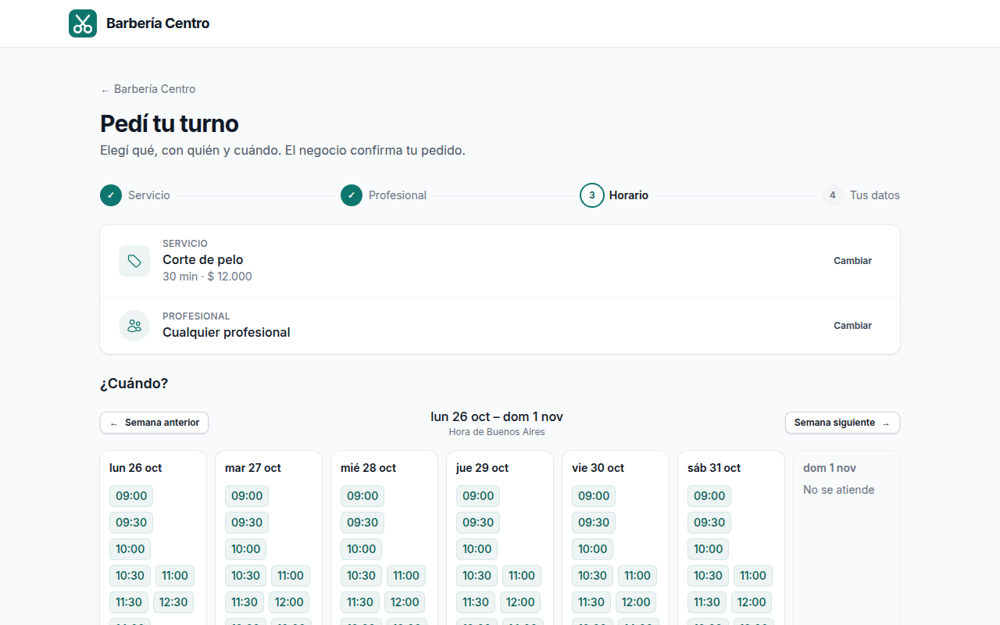
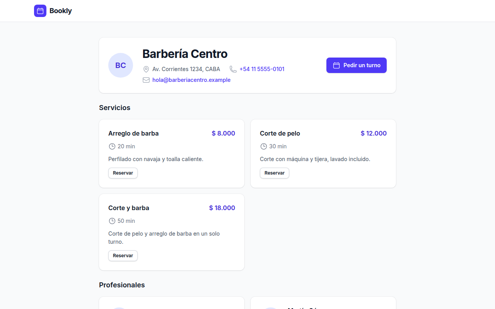
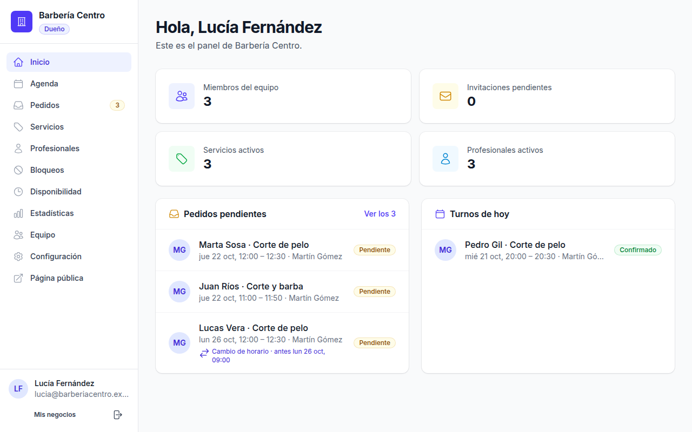
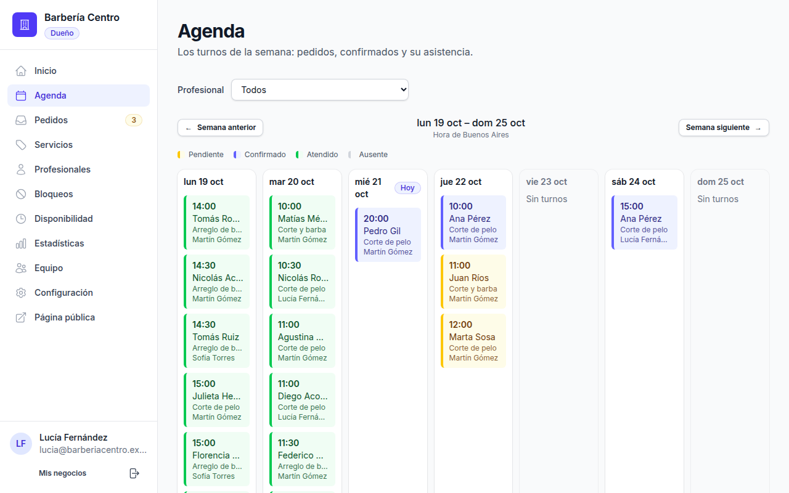
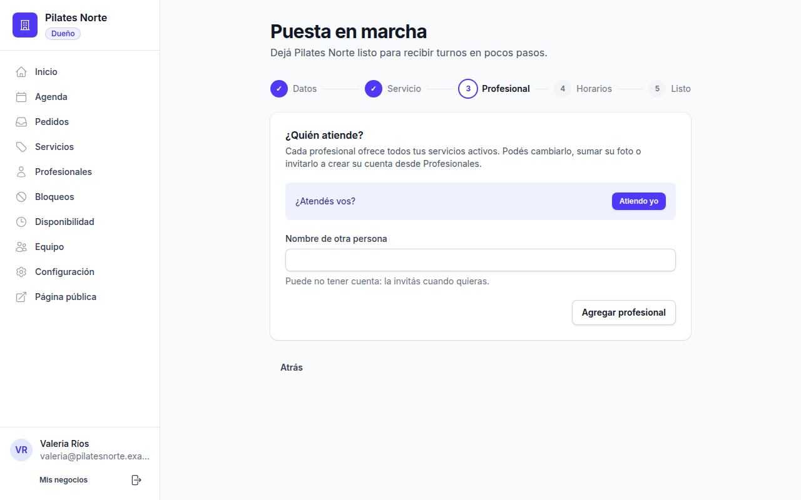
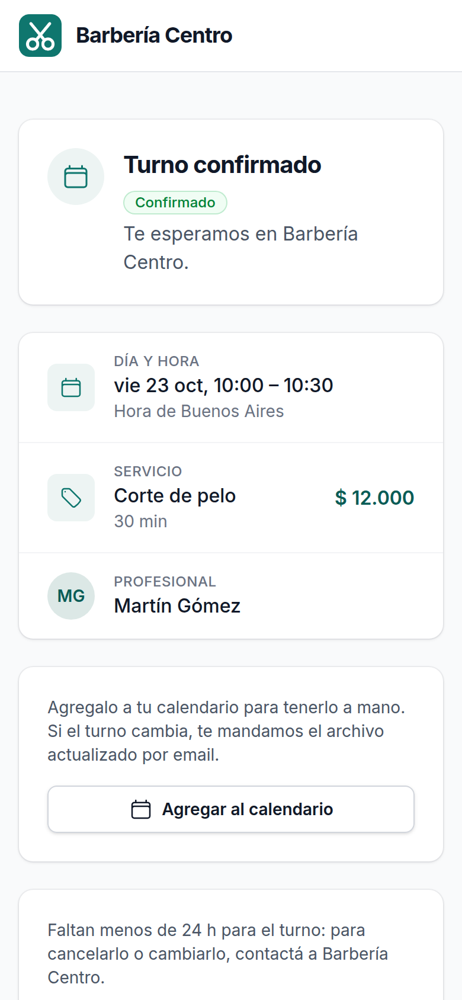
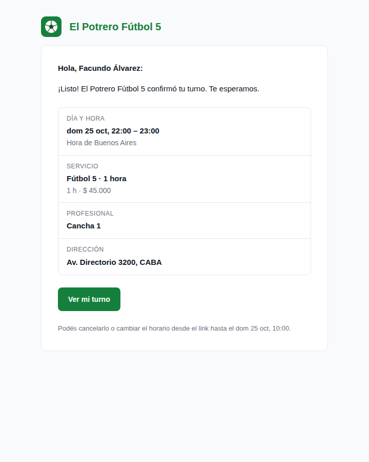
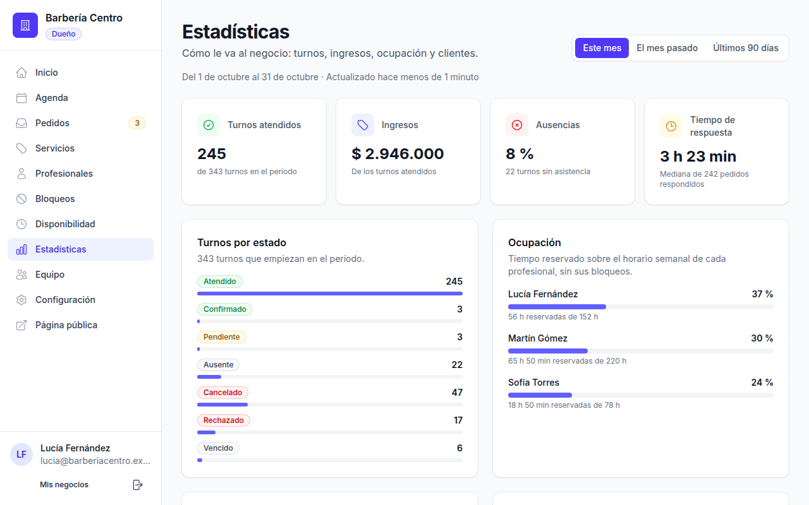
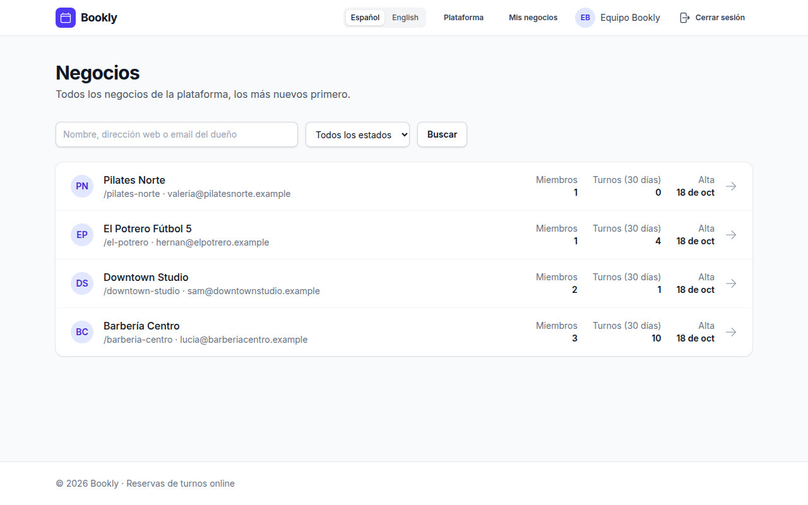

# Bookly

Online appointment booking for businesses that work by schedule: barbershops, clinics, studios, sports courts. Each business gets its own public page with its services, professionals and hours; customers request appointments without creating an account, and the business confirms them from a live panel. A single app serves many businesses (multi-tenant) without mixing their data.

Built with Rails 8.1, Ruby 3.4, PostgreSQL, Hotwire and Tailwind 4. No Node, no Redis.



## Table of Contents

- [Features](#features)
- [Screenshots](#screenshots)
- [Architecture](#architecture)
- [Data model](#data-model)
- [Design decisions](#design-decisions)
  - [Multi-tenancy](#multi-tenancy)
  - [Availability and double booking](#availability-and-double-booking)
  - [Appointment lifecycle](#appointment-lifecycle)
  - [Emails, calendar files and reminders](#emails-calendar-files-and-reminders)
  - [Live updates](#live-updates)
  - [Statistics and caching](#statistics-and-caching)
  - [Time zones and languages](#time-zones-and-languages)
- [Security](#security)
- [Testing](#testing)
- [Tech stack](#tech-stack)
- [Getting started](#getting-started)
- [Roadmap](#roadmap)

## Features

**For customers** (no account needed)

- **Booking in four steps** from the business's page: service, professional (or "any"), a free time and contact details. With "any professional" the least busy free one is assigned. The request holds the time until the business answers.
- **A personal link** to follow the appointment: its status, the business's reason if it was rejected or cancelled, a calendar file once it's confirmed, and the business's contact. The page updates by itself when the business answers.
- **Cancel or reschedule** a confirmed appointment, or withdraw a request, until the business's cancellation window closes. Rescheduling frees the old time at once and waits for the business's confirmation again.
- **Emails for every change** (request received, confirmed, rejected, cancelled, expired, moved to another professional, change of time received) and a reminder before the appointment, with `.ics` files that keep the customer's calendar up to date.

**For businesses**

- **Sign up** at `/signup` and a **setup assistant**: the business's details, a first service, who offers it and their weekly hours, until the public page takes bookings. Signed in users can add more businesses to their account.
- **A live panel:** a dashboard with pending requests and today's appointments, a requests list (the ones expiring first on top) and a weekly agenda per professional or of everyone. Everything refreshes by itself when a request comes in or an appointment changes.
- **Request management:** confirm or reject (with a reason the customer sees), reassign to another free professional, cancel with a reason, and mark attendance once the appointment starts. Requests nobody answers expire on their own, and every change is kept in the appointment's history.
- **Statistics** for this month, last month or the last 90 days: appointments by status and the no-show rate, revenue, the most requested services, each professional's occupancy, peak days and hours, new and returning customers, and how long the team takes to answer. Owners and admins see the whole business; professionals, their own numbers.
- **Services and professionals:** duration, price, optional break and rich text description; profiles with photo, offered services and an optional linked account. Neither is ever deleted, only deactivated.
- **Weekly hours and blocks:** several ranges per day, and blocks for vacations or errands (exact times or whole days).
- **Team and roles:** the owner invites admins and professionals by email (single use links, valid for 7 days), changes their roles and removes them. Owners and admins manage everything; professionals answer and manage their own appointments.
- **Settings:** the business's details (name, contact, address, time zone, language, currency) and its booking rules: start interval, break between appointments, minimum notice, booking horizon, request expiration, cancellation window and reminder.
- **Emails to the team** when customers request, reschedule or cancel; replies go straight to the customer.

**For the platform**

- **A platform panel** at `/platform` for Bookly's own team: every business with its owner, members and recent activity, search and filters, each business's details and team, and suspending or reactivating it.

**Everywhere**

- **Spanish and English.** Business pages and emails use the business's language and time zone; everything else follows the visitor's browser, with a language switcher.
- **Responsive UI** built from a small set of shared components, with a sidebar panel that collapses on phones.

## Screenshots

| | |
|---|---|
|  |  |
| **Public page:** services, prices and the business's contact | **Panel home:** requests waiting for an answer and today's appointments |
|  |  |
| **Agenda:** the week, by professional or of everyone, refreshing live | **Setup assistant:** from sign up to a bookable page |
|  |  |
| **The customer's link** on a phone: status, details, calendar file, cancel or reschedule | **Confirmation email** in the business's name, with the `.ics` attached |



**Statistics:** the month's numbers for the whole business, from the cache



## Architecture


Bookly is a single Rails app rendering HTML. Hotwire does the rest on the client: Turbo Drive for navigation and forms, Turbo 8 page refreshes for live updates and a few Stimulus controllers.

- **Three areas, one app.** Public pages live under `/:business_slug` (the business page, the booking steps, the customer's link), the business panel under `/:business_slug/admin`, and the platform panel under `/platform`. Global routes (`/session`, `/signup`, `/dashboard`, ...) come first, and their names are reserved so no business can take them as a slug.
- **The tenant comes from the URL.** `SetCurrentBusiness` finds the business by its slug, sets `Current.business` and wraps the request in its language and time zone. Every per-business model includes `BusinessScoped`, which filters each query by the current business and fails closed: with no business set, a query raises instead of returning everyone's rows.
- **Domain logic in models and form objects.** `Availability` computes free times; `Appointment` owns its transitions (each one locks the row, checks the status, saves and records an `AppointmentEvent` in one transaction); form objects (`AppointmentRequest`, `AppointmentReschedule`, `BusinessRegistration`, `SetupHours`) handle what spans several records.
- **Side effects after commit.** An `AppointmentEvent` notifies the right people when its transaction commits, and an appointment broadcasts a refresh. A rolled back change emails nobody and refreshes nothing.
- **Solid Queue, Solid Cable and Solid Cache** replace Redis: jobs, websocket messages and cache live in their own PostgreSQL databases. `bin/jobs` runs the job workers and two recurring jobs: `ExpireRequestsJob` every minute and `SendRemindersJob` every five minutes. The cache holds the statistics and the rate limits' counters.
- **Deployment** is set up for Kamal with Docker, with Thruster in front of Puma (not deployed yet).

## Data model


- **Global tables** are how users reach their businesses: `users`, `sessions`, `memberships` (a user's role in a business, with exactly one owner per business, enforced by a partial unique index) and `invitations`. `businesses` holds each business's configuration and status.
- **Per-business tables** carry a `business_id` on every row and a unique `(business_id, id)` index. They reference each other through **composite foreign keys** (`(business_id, professional_id)` → `professionals (business_id, id)`), so the database itself rejects an appointment whose service belongs to another business.
- **A professional is a profile, not a user.** It can exist without an account (a pitch on a football court, or someone not invited yet) and be linked to a member later; the link is a composite foreign key to `memberships`, so only members of the business can be linked.
- **Customers have no account:** they're identified by email, unique per business. Their personal link is a signed token (`generates_token_for`), not a stored secret.
- **Appointments copy what can change:** the price and the break are copied from the service when booked, so editing a service doesn't alter existing appointments. `ends_at` and `buffer_ends_at` are derived from the start.
- **History is append only.** Every status change, reassignment and reschedule adds an `AppointmentEvent` with who did it (customer, a team member or the system), the team's reason and the details in `metadata`. Events are read only once saved.
- **Services and professionals are never deleted**, only deactivated, so their history stays intact. Instants are stored in UTC; working hours are wall clock times in the business's zone.

## Design decisions

### Multi-tenancy

One database with shared tables, a `business_id` on every per-business row, and the current business in `Current.business`. It's the simplest model to run, and three layers keep businesses apart:

1. **Queries:** `BusinessScoped` filters by the current business and assigns it to new records. It fails closed (`Current::MissingBusiness`), also through associations, so a job or console session that forgets to set the tenant breaks loudly instead of touching every business.
2. **Database:** composite foreign keys make mixed rows impossible, whatever the code does.
3. **Requests:** the business comes from the URL, never from a parameter; panel queries also go through the member's permissions (`Membership#visible_appointments`), and anything outside them is a 404.

Code that legitimately spans businesses (the expiration and reminder jobs, the platform panel) opts out explicitly with `BusinessScoped.across_businesses { ... }`, so cross-tenant access stays greppable. A schema-per-business version is on the roadmap as a comparative exercise.

### Availability and double booking

`Availability` computes free start times for a service, with one professional or any, for any range of days in three queries. Start times are counted from the start of each working range every `slot_interval_minutes`; the service must fit in the range, can't overlap a block, and service plus break can't overlap another active appointment's. Minimum notice and the booking horizon bound the window.

Checking availability isn't enough when two customers book the same time at once. The database has the last word: **exclusion constraints** (`btree_gist`) reject overlapping ranges per professional, for active appointments (`tsrange(starts_at, buffer_ends_at)`), working hours and time blocks. `OverlapConstraint` turns the database's error into a normal validation error, so the customer sees that the time was just taken and, with "any professional", the next free professional is tried.

Pending requests hold their time too: a request is a real booking waiting for confirmation, not a wish list.

### Appointment lifecycle

| Change | Who | The customer gets |
|---|---|---|
| Request (`pending`) | Customer | "Request received"; the team gets an email too |
| `pending` → `confirmed` | Team | Confirmation with an `.ics` |
| `pending` → `rejected` | Team, with a reason | The reason and a link to book again |
| `pending` → `expired` | System, when nobody answered in time | A link to book again |
| `pending` → `cancelled` | Customer, withdrawing it | A receipt; the team gets an email |
| `confirmed` → `cancelled` | Team (with a reason) or customer (within the window) | The cancellation and an `.ics` that removes the event |
| `confirmed` → `pending` | Customer, rescheduling | "Change of time received"; the team gets an email. If the business rejects it or doesn't answer, the appointment is lost (the customer is told before confirming) |
| Reassignment (status unchanged) | Team | The new professional |
| `confirmed` → `attended` / `no_show` | Team, once it started | Nothing |

Every transition locks the appointment's row, checks that it still applies and raises `Appointment::InvalidTransition` otherwise, so two members answering the same request at once can't both win. Acting on a request past its deadline expires it instead.

### Emails, calendar files and reminders

- **One trigger.** Emails go out from `AppointmentEvent`'s `after_create_commit`, whatever caused the change: the panel, the customer's link or a job. Nothing is sent for a change that rolled back.
- **The tenant travels as ids.** Mailers are parameterized with the business and ids, never records: the job delivering the email has no current business, and loading a scoped record before setting it would fail. `BusinessMailer` sets the business, its language and its time zone around each email.
- **Sent by the platform, in the business's name.** Every email comes from one address (`BOOKLY_MAIL_FROM`) with the business's name, and replies go to the business (or, for team emails, to the customer).
- **Calendar files that update.** Each appointment has a fixed `UID` and a `SEQUENCE` that grows with its history, so a newer `.ics` updates the event instead of duplicating it, and cancellations remove it.
- **Reminders, exactly once.** `SendRemindersJob` marks `reminder_sent_at` with a conditional update before enqueueing the email, so overlapping runs can't send two. An appointment confirmed after its reminder was due gets none (the confirmation just told the customer), and rescheduling clears it.

### Live updates

Pages that show appointments (the panel's dashboard, requests and agenda, the public week of free times, the customer's link) subscribe to a stream and refresh themselves with Turbo 8 morphing, keeping the scroll. Broadcasts carry no data, only "something changed": each page reloads with its viewer's own permissions, so nothing can leak between professionals or businesses, and there are no partials to keep in sync. Stream names are signed and include the business. Pages with forms don't subscribe, so a refresh never wipes what someone is typing.

### Statistics and caching

`BusinessStats` calculates a period's numbers from the appointments the member can see (`Membership#visible_appointments`), so professionals get their own without a separate code path. Each number is one aggregate query in PostgreSQL: counts and sums grouped by status, service or professional, peak hours with `EXTRACT` on the start converted to the business's time zone, new customers by their first appointment, and the response time as a `PERCENTILE_CONT` median over the appointment's history, using `LAG` to find when each answered request became pending. Occupancy compares the booked minutes with the professionals' weekly hours on each day of the period, less their blocks.

The result is a hash of plain values, cached as a whole in Solid Cache. The key holds the business, the period's first day (so "this month" changes key when the month does), who's looking (managers share one entry; each professional has their own) and a version to bump if the hash changes shape. Nothing invalidates it on a change; it expires instead: after 10 minutes for a period still going on, after a day for a closed one, which only changes when attendance is marked late. The page says how old the numbers are. Invalidating on every appointment change would mean a query per visit to check, for numbers nobody needs to the minute.

### Time zones and languages

Instants are stored in UTC and shown in the business's time zone; inside a request `Time.zone` is the business's. Working hours are wall clock times (`09:00` means nine in the business's zone, whatever the season). Every string goes through `t()` in Spanish and English, missing translations raise in development and test, and a spec fails if both languages don't define the same keys.

## Security

- **Authentication** comes from the Rails 8 generator: bcrypt passwords, a signed, `httponly` session cookie and password reset by email. Authentication is required by default; public controllers opt out explicitly.
- **Access is checked per area.** Non-members get a 404 from a business's panel, and anyone without `platform_admin` gets a 404 from `/platform`, so neither reveals what exists. Inside the panel, owner and manager actions are guarded per action, and professionals only see their own appointments.
- **Tokens instead of stored secrets.** Invitation and appointment links use `generates_token_for`: invitations embed their acceptance and expiration, so a link works once and resending voids the previous one; nothing reusable is stored in the database.
- **Rate limits** per IP on sign in, password reset, sign up, booking, cancelling and rescheduling.
- **The customer's pages** aren't indexed by search engines (`noindex`), and websocket streams only accept signed names.
- **The database enforces the invariants** the code relies on: composite foreign keys between businesses, exclusion constraints against double booking and check constraints mirroring the validations.
- **CI** runs Brakeman, bundler-audit and importmap audit on every push.

## Testing

- **RSpec** with FactoryBot: about 830 examples covering models, form objects, jobs, mailers, helpers and requests. Request specs exercise the full stack (routing, tenancy, permissions, rendering) against a real PostgreSQL database, with no mocks of the database: the exclusion and check constraints are tested too.
- **Time is frozen** (`travel_to`) wherever the result depends on it: availability, expiration, reminders, the agenda, the statistics' periods.
- **The statistics** are tested metric by metric against hand-built histories (the period's edges in the business's time zone, prices copied at booking, reassignments that don't restart the response clock), and their cache by its hits, its expirations and the entries each member and business gets.
- **Live updates** are tested by checking which signed streams each page subscribes to, and the broadcasts each change makes.
- **Emails** are tested in both languages and time zones, including their `.ics` attachments, and every email has a preview at `/rails/mailers` built from the seeded data.
- **CI** (GitHub Actions, mirrored locally by `bin/ci`) runs RuboCop, the three audits and the suite.

## Tech stack

- Ruby 3.4.1 and Rails 8.1
- PostgreSQL, with `btree_gist` for the exclusion constraints
- Hotwire: Turbo 8 (Drive, page refreshes with morphing) and Stimulus, through importmap
- Tailwind CSS 4 (`tailwindcss-rails`), Propshaft
- Solid Queue, Solid Cable and Solid Cache
- Action Mailer with `letter_opener_web` in development, `icalendar` for the `.ics` files
- Action Text (service descriptions) and Active Storage (professionals' photos)
- `rails-i18n`, with Spanish and English
- RSpec, FactoryBot, RuboCop (rails-omakase), Brakeman, bundler-audit
- Kamal, Docker and Thruster for deployment

## Getting started

### Requirements

- Ruby 3.4.1
- PostgreSQL (local socket, authenticated as your OS user)

### Setup

```bash
bin/setup --skip-server   # install gems, create and migrate the databases
bin/rails db:seed         # sample businesses and users
bin/dev                   # web server on http://localhost:3000, background jobs and Tailwind watcher
```

Background jobs (Solid Queue, `bin/jobs`), live updates (Solid Cable) and the cache (Solid Cache) use their own databases in development too (`bookly_development_queue`, `bookly_development_cable` and `bookly_development_cache`, created by `bin/setup`). `bin/dev` runs the jobs; without them requests don't expire, reminders aren't sent and no email goes out.

Caching is off in development until `bin/rails dev:cache` turns it on (run it again to turn it off). While it's off, the statistics are calculated on every visit and rate limits don't count.

### Sample data

Sample businesses:

- http://localhost:3000/barberia-centro — a barbershop, in Spanish (Buenos Aires)
- http://localhost:3000/downtown-studio — a hair studio, in English (New York)
- http://localhost:3000/el-potrero — a football court, in Spanish (Buenos Aires), whose "professionals" are its pitches, booked by the hour

Sample users, all with the password `password` (sign in at http://localhost:3000/session/new):

| Email | Role |
|---|---|
| lucia@barberiacentro.example | Owner of Barbería Centro |
| diego@barberiacentro.example | Admin of Barbería Centro |
| martin@barberiacentro.example | Professional in Barbería Centro and Downtown Studio |
| sam@downtownstudio.example | Owner of Downtown Studio |
| hernan@elpotrero.example | Owner of El Potrero Fútbol 5 |
| admin@bookly.example | Platform admin (http://localhost:3000/platform) |

Every business comes with services, professionals, weekly hours, a few upcoming blocks and some appointments in the coming days, with their history. Barbería Centro also gets, whenever it has none, a request expiring in two hours, an appointment that started an hour ago and a change of time waiting for an answer (Lucas Vera), to try answering requests and marking attendance in the panel (Pedidos / Agenda). It has the last 90 days of appointments too, with their outcomes and history, for the statistics page (Estadísticas). It also has an inactive service, a professional profile without an account (Sofía Torres) to try inviting someone from their profile, and a rejected request, an appointment the business cancelled and an expired request.

To try a booking, use the button on a business page ("Pedir un turno" / "Book an appointment"). To try the sign up and the setup assistant, use "Registrar mi negocio" / "Sign up my business" on the landing page, or "Crear un negocio" from the businesses list when signed in.

### Emails in development

Emails sent in development (invitations, password resets, appointment emails and reminders) can be read at http://localhost:3000/letter_opener. Seeding sends none; every appointment email can be previewed with the seeded data at http://localhost:3000/rails/mailers. Emails are sent from `no-reply@bookly.test` unless `BOOKLY_MAIL_FROM` says otherwise.

### Tests and checks

```bash
bundle exec rspec   # test suite
bin/ci              # RuboCop, bundler-audit, importmap audit, Brakeman and RSpec
```

## Roadmap

- [x] Businesses and tenant context
- [x] Users, authentication, roles and professional invitations
- [x] UI foundation: theme, components and layouts
- [x] Services and professionals
- [x] Working hours and schedule blocks
- [x] Availability calculation
- [x] Public appointment request
- [x] Request management and live schedule (confirm, reject, reassign, expiration)
- [x] Appointment management by personal link (cancel, reschedule)
- [x] Emails and reminders
- [x] Business sign up, setup assistant and platform panel (completes the MVP)
- [x] Project documentation: architecture, data model, design decisions and screenshots

After the MVP, step by step:

- [x] Business statistics, cached with Solid Cache
- [ ] Subdomains and branding
- [ ] Schema-per-business migration (comparative exercise)
- [ ] Deployment
